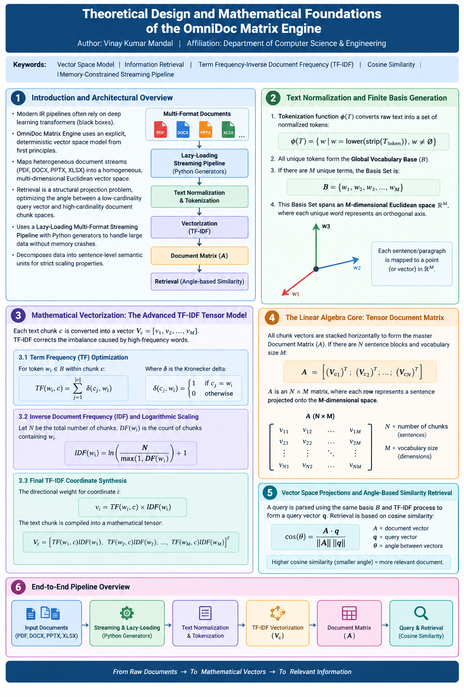

# OmniDoc Matrix Engine

A lightweight, memory-efficient Document Search Engine built from scratch using pure mathematics and Python. It processes multiple document formats on a sentence level and uses Vector Space Modeling for text retrieval.

<p align="center">
  
</p>

## Features
- **Universal Streaming Parser:** Lazy-loads content from PDF, DOCX, PPTX, and XLSX formats without loading the entire file into RAM, preventing memory crashes.
- **Mathematical Core:** Implements custom TF-IDF (Term Frequency-Inverse Document Frequency) vectorization without external machine learning libraries.
- **Vector Space Matching:** Uses Cosine Similarity to analyze structural angles between query vectors and document chunk spaces.
- **Granular Chunking:** Automatically splits large paragraphs into optimized sentence-level arrays to preserve vector balance and boost search precision.

## Project Structure
```text
omnidoc_matrix_engine/
│
├── core/
│   ├── __init__.py
│   ├── parser.py         # File streaming logic & chunking handlers
│   └── vectorizer.py     # Math functions (TF-IDF & Cosine Similarity)
│
├── datasets/             # Directory to place input files
│   └── test.docx
│
├── main.py               # Main execution and query loop
└── README.md
```

## Setup & Installation

1. Clone or navigate to your project root folder:
   ```bash
   cd omnidoc_matrix_engine
   ```

2. Activate your virtual environment (if applicable) and install the lightweight document dependencies:
   ```bash
   pip install pypdf python-docx python-pptx openpyxl
   ```

## Usage

1. Place your target document (PDF, DOCX, PPTX, or XLSX) inside the `datasets/` directory.
2. Open `main.py` and set your configuration path:
   ```python
   file_path = "datasets/your_file.pdf"
   ```
3. Run the search engine from your terminal:
   ```bash
   python main.py
   ```
4. Enter your technical or structural search phrases into the prompt. Type `exit` to close the engine.


# 💬 Frequently Asked Questions (FAQ)

### Q1: This engine is trained on which dataset? 
**Answer:** 
The OmniDoc Matrix Engine is a **non-parametric, zero-shot deterministic engine**. It does not undergo traditional machine learning training and does not rely on any pre-trained datasets (like Wikipedia or Common Crawl). 

Instead, it operates on a **dynamic vector space model**. The moment you feed a document (PDF, DOCX, etc.) into the pipeline, the engine dynamically constructs its vocabulary framework from that specific file at runtime. **In short, your input document is its dataset.**

---

### Q2: Is this a Deep Learning or LLM-based search tool? 
**Answer:** 
No. Unlike modern AI tools that act as operational "black boxes," this engine is built entirely from **first principles of Linear Algebra**. It uses explicit mathematical tensor structures, Logarithmic Term Frequency-Inverse Document Frequency (TF-IDF) scaling, and Hyper-dimensional Cosine Similarity (cos θ) to map and retrieve data with 100% predictability.

---

### Q3: How does it protect data privacy? 
**Answer:** 
Because there is zero pre-training and no external API dependencies (like OpenAI or HuggingFace), **your data never leaves your local machine**. All vector operations, text normalization, and tensor mappings happen locally and in memory, ensuring absolute data privacy for enterprise and corporate documents.

---

### Q4: Why did you split the text into sentences instead of large paragraphs? 
**Answer:** 
To bypass the **Magnitude Distortion Deficit**. In large text chunks, vector magnitudes (||Vc||) become heavily inflated, which artificially dampens the cosine similarity score of highly relevant terms. A granular sentence-level split keeps the vector lengths balanced relative to the query, driving clinical precision during the mathematical inner product mapping.

---

### Q5: Will it crash if I upload a massive 10,000-page document? 
**Answer:** 
No. The core engine is engineered with a **Lazy-Loading Multi-Format Streaming Pipeline** powered by Pythonic generator architectures. Instead of loading the entire corporate repository into the RAM linearly, data blocks are parsed sequentially and evaluated on the fly, maintaining a **Constant Memory Space Complexity O(1)**.
